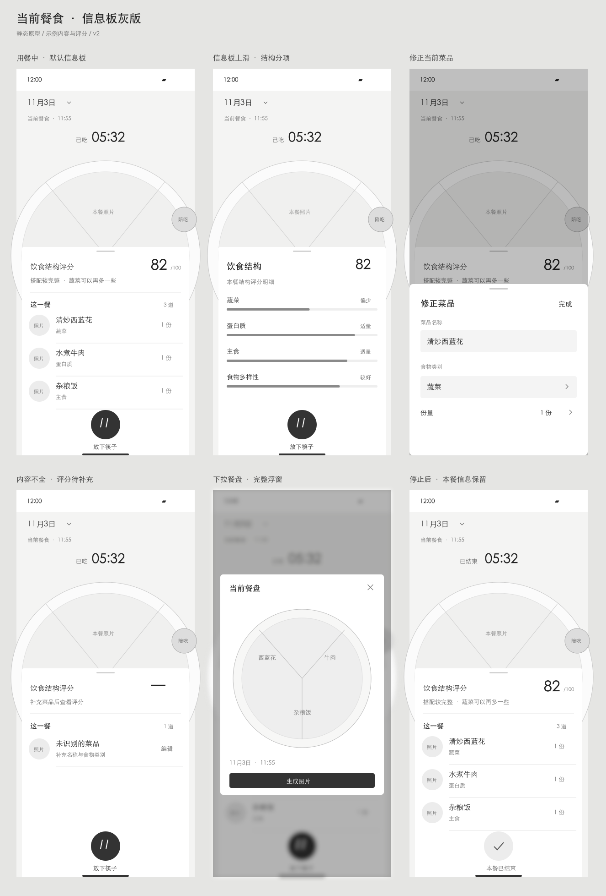

# 当前餐食：静态灰版 v2

2026-11-05（Asia/Shanghai）。设计评审稿，不是可交互 H5，不代表功能实现或部署。根据用户原图保留日期、计时、大餐盘、默认遮挡信息板、侧边陪吃与底部停止。

## 本轮调整

信息板主要呈现当前这一餐的内容与饮食结构评分。默认顶部是结构评分及一句解释，下方是菜品照片、名称、类别与份量；滚动状态展示结构分项。采用同一套列表、分隔线、条形分项、表单和底部弹层，黑白灰、4–8px 圆角，停止按钮保留圆形。没有新增导航或固定三餐分类。

- [用餐中](01-current.png)：总分、菜品清单。
- [结构分项](02-structure.png)：信息板内部滚动后的内容，不是新页面。
- [菜品修正](03-edit.png)：修正名称、类别与份量。
- [信息不足](04-incomplete.png)：待补充，不显示虚构分数。
- [完整餐盘](05-full-plate.png)：手动下拉后的浮窗，下方模糊。
- [停止后](06-stopped.png)：停止对应当前餐，保留内容和评分。

全部 PNG 是静态画稿，各有同名可编辑 SVG。盘子、照片和陪吃角色用灰度占位，不借用用户截图中的第三方角色，不包含个人餐照。82 分、份量及分项长度仅供布局示例；评分维度、算法与营养解释均未定义，不应作为饮食建议或实际评分输出。未增加能量、营养素克数或自动咀嚼检测。

组件参考入口：[Apple 列表](https://developer.apple.com/design/human-interface-guidelines/lists-and-tables)、[Apple Sheets](https://developer.apple.com/design/human-interface-guidelines/sheets)。沿用原生列表与弹层的熟悉形式，不复制健康 App 的页面导航或活动圆环。

验证范围：逐张检查 390×844 逻辑尺寸与六状态总览；原图、上传裁剪、日历及陪吃完整展开状态本轮未重画。没有功能代码、生产数据或数据库修改，保留 gray-v1 历史样机。回退只需参照上一份设计，无线上影响。
