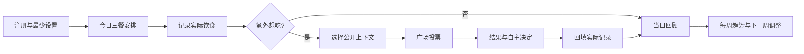

# 嘴巴等等我：完整产品方案 v0.2.0

- 方案日期：2026-10-26（Asia/Shanghai）
- 状态：产品设计基线；具体参数是本次建议，尚未通过真实用户实验验证。
- 对应应用：现有 Web v0.1.0；本文的新能力尚未实现。方案版本和应用版本分别管理。
- 本次依据：创始人的核心概念、思考和 MVP 结构，以及现有代码审阅。未开展竞品实测，不把竞品判断当作已证实事实。

## 一、核心概念

### 1. 一句话定位

帮助用户通过每日饮食安排、真实记录和饭友建议，逐步建立对自己饮食选择的掌控感。

内部核心是“身体控制”，面向用户表达为“了解自己的饮食，做自己愿意坚持的选择”。控制权属于用户。产品中的“审批”是用户主动选择的约定，不是他人决定一个人是否有资格吃饭。

品牌沿用“嘴巴等等我”，主张“每一口有记录，每一次想吃有人陪”。产品不承诺减重结果，不把某种食物、某次额外进食或体型贴上好坏标签。

### 2. 核心途径

| 行为 | 用户问题 | 产品动作 | 结果 |
|---|---|---|---|
| 每日安排 | 今天大概怎么吃？ | 安排早餐、午餐、晚餐，可复制昨天并随时调整 | 一份可变更的计划 |
| 实际记录 | 我实际吃了什么？ | 记录餐次、食物、份量和时间 | 个人饮食历史 |
| 额外想吃 | 计划之外还想吃，要不要？ | 带上下文向广场提交一张审批单 | 允许／暂不允许／意见不足 |
| 决定与回顾 | 最后怎么选，感觉如何？ | 记录实际选择和简短感受 | 下一次选择的参考 |
| 长期观察 | 我经常在什么情境想吃？ | 看 7／28 天已记录的饮食倾向 | 调整自己的安排 |

“三餐记录”和“额外审批”分开：三餐无需通过审批才能记录或进食；额外想吃可进入公开审批。记录和审批单是两个独立对象，通过编号关联，避免把“想吃”误算成“已经吃了”。

### 3. 首批用户与使用情境

首批面向自愿参与的成年朋友小群：有饮食管理意愿，但觉得独自记账难坚持；愿意分享有限的饮食上下文，也愿意给朋友建议。先服务日常饮食管理，不把治疗性饮食、未成年人减重或孕期营养作为首版适用场景。

典型情境：用户午餐后想买奶茶，提交“中杯、半糖、今天午餐已吃、现在想解馋”；饭友看到用户主动公开的摘要后投票；截止后用户仍可决定买、换小杯、稍后再说或不买，并补记结果。

### 4. 为什么使用我们

差异假设是“有上下文的审批 + 长期记录 + 可调语气的陪伴”，而不是票数更多。用户提及的“钱包等等我／钱包请等等”作为灵感来源；“它只有单次审批”目前是用户观察，待竞品实测。

验证方式：在同意公开信息的内测者中，对比只有食物名的审批卡与包含自选上下文的审批卡，访谈建议是否更有帮助；不以“不允许”的比例或减重速度判断胜负。

## 二、产品原则与关键取舍

1. 自主：任何结果都可由本人作最终决定；不锁定下一餐、不禁止记录、不处罚补记。
2. 真实：鼓励记录实际情况；遗漏、忘记和临时改变主意都能补充。记录是自述，不代表已核实。
3. 健康：评分评价记录和复盘过程，不奖励少吃、低热量、快速减重或高审批通过率。
4. 温和：允许直接、幽默、简短的表达，但不使用羞辱、体型攻击、威胁或惩罚性运动建议。
5. 私密：个人历史默认私密，提交审批时逐项预览公开内容；体重、体脂、经期备注不进入广场。
6. 诚实呈现：缺失数据是“未知”，不是 0；营养估算是估算，不是精确检测。
7. 小步验证：先解决记录与审批的闭环，再增加营养估算、AI 和小程序；不开启未授权的付费服务。

体重由多种因素共同影响，不能作为“测谎仪”；药物、睡眠等也可能影响体重。[依据：NIDDK](https://www.niddk.nih.gov/health-information/weight-management/adult-overweight-obesity/factors-affecting-weight-health)

经前症状可以包含腹胀、食欲变化。用户可以自愿备注，产品不自动推断经期，不按周期扣分，也不声称能用公式“排除”这些影响。[依据：NHS](https://www.nhs.uk/conditions/pre-menstrual-syndrome/)

## 三、用户需要登记什么

| 阶段 | 必填 | 选填 | 默认可见范围 |
|---|---|---|---|
| 注册 | 昵称、邮箱、密码、成人使用确认、隐私与社区约定 | 无 | 邮箱仅本人；昵称随公开内容展示 |
| 首次设置 | 确认时区，默认设备时区 | 目标“规律记录／减少临时决定／观察营养”、饭点、陪伴语气 | 本人 |
| 三餐计划 | 日期、餐次、预计食物或“暂未决定” | 预计份量、时间 | 本人 |
| 实际饮食 | 日期时间、餐次、食物、状态“已吃／未吃／不适用” | 份量、饥饿感、感受、来源 | 本人；另有明确发布动作 |
| 额外审批 | 想吃什么、预计份量、预计时间、公开预览确认 | 动机标签、愿意分享的今日摘要、替代方案 | 登录用户可见 |
| 决定回填 | 已吃原方案／换了方案／没吃／暂未决定 | 实际份量、满意度、原因 | 实际记录默认私密 |
| 身体观察 | 无 | 体重、测量时间、体脂和设备来源 | 本人 |
| 特殊情况 | 无 | 自愿填写的经期／睡眠／压力等备注 | 本人；不默认进入 AI |

最小记录应能在约 30 秒内完成，此为待测可用性目标。首版不强制身高、体重、性别、每日热量目标或食物照片。需要营养估算时再询问相应份量，不能把注册变成健康问卷。

身体数据是后续可选模块，不影响首版注册和使用。拒绝填写选填项不能降低评分或功能权限。

## 四、最小 MVP 页面结构

Web 优先做好手机屏幕；登录后一级导航为“今日”“吃饭广场”“我的”。原有成就和提醒移入对应页面，减少首屏入口。

### 1. 登录页面

注册／已有账号切换，昵称、邮箱、密码，密码长度提示；加载、重试、错误提示明确。登录失败不清空已填邮箱，不回显密码。

公开扩量前补齐邮箱验证、限流和密码找回。当前 v0.1.0 没有邮件验证与找回，不把未实现按钮摆出来；小规模试用阶段应明示此限制。

### 2. 今日：信息管理页面

从上到下：日期与问候 → 今日进度 → 三餐卡片 → “额外想吃”主按钮 → 待回填事项 → 成就进度 → 7 日摘要。

- 今日进度：显示已完成项目；点开看到评分公式和缺少的记录。全天未结束时显示“记录中”，不下健康结论。
- 三餐卡片：计划与实际并列；支持“按计划吃了”“记录不同内容”“尚未记录”。计划没有填写也可直接记实际。
- 额外想吃：进入审批编辑；已吃的额外饮食走补记入口，不伪装成事前申请。
- 进度与成就：突出本周记录天数、已解锁勋章，允许隐藏数字评分。
- 我的审批摘要：提交数、待投票数、待回填数；通过率仅在有足够已结算样本时展示。
- 体重入口：后续版本可选卡片，默认不放在首屏主要位置。

空状态：“今天还没开始记录，先记下这一餐就好。”离线或请求失败时保留本次编辑内容，标记“尚未保存”，不显示虚假的成功状态。

### 3. 吃饭广场

两个标签：“广场”“我的提交”。

广场首版展示额外审批单；默认按最早截止排序，同截止时间按创建时间升序。显示昵称、想吃内容、份量、截止时间、自选公开摘要、投票入口。支持“只看待投票”，不按体重、热量或争议程度排行。

我的提交展示草稿、投票中、已结算、已撤回；卡片上能看结果并回填最终选择。公开三餐和点赞作为后续“分享”内容类型，不能与审批单混淆。

点击卡片进入详情：食物与份量、理由、公开上下文、截止与票数要求、投票、我的选择。首版使用固定理由标签，不开放自由评论；提供举报、屏蔽作者、撤回公开内容。

### 4. 我的

个人记录与 7／28 日趋势、成就、提醒、陪伴偏好、隐私与数据导出／删除、账号设置。网页提醒继续采用“页面打开时提醒 + 日历导出”，不承诺关掉网页后的微信消息。

### 5. 主路径

## 五、审批规则：从“想吃”到“最后怎么选”

### 1. 审批对象

用户选择“额外想吃”创建审批单：加餐、额外饮品、夜宵等。餐次标签不自动决定规则，例如随午餐吃的饮品可属于午餐；用户判断是否超出自己的安排。

审批仅面对未来的决定。已经吃过的内容可以诚实补记，不需要追溯批准。三餐既可以私密记录，也可在后续分享模块公布，但不参与新版额外审批统计。

### 2. 初始参数与计算

以下为 v0.2.0 设计默认值，首批内测后再调整；规则版本写入每张审批单，后续调参不回算旧结果。

| 项目 | 默认规则 |
|---|---|
| 谁能投票 | 所有已登录、未受限用户；本人不能投自己；后续扩量要求已验证邮箱 |
| 次数 | 每人每单一票；截止前可改票或撤票，最终只计一票 |
| 选项 | “允许这一口”“暂不允许，换个方案” |
| 理由 | 选填固定标签，如“份量合适”“建议小份”“信息不足”；不支持人身评论 |
| 时间 | 提交时选择 15／30／60 分钟，默认 30 分钟，提交后不延长 |
| 最少票数 | 3 张有效票 |
| 允许 | 截止时有效票数 ≥ 3，且支持票占比 ≥ 2/3 |
| 暂不允许 | 截止时有效票数 ≥ 3，且支持票占比 < 2/3 |
| 意见不足 | 截止时有效票数 < 3；不是拒绝，不自动当作允许 |
| 提前结算 | MVP 不支持，避免挑选对自己有利的时刻结束 |
| 票数展示 | 投票中仅显示参与人数和截止时间，结算后公开支持／反对计数；不公开投票者名单 |
| 最终选择 | 本人随时可自行决定；结束后回填原方案／替代方案／没吃，均可正常记账 |

边界示例：2 支持 + 1 反对 → 允许；1 支持 + 2 反对 → 暂不允许；2 支持 + 2 反对 → 暂不允许；2 支持 + 0 反对 → 意见不足。产品必须说明这是社交规则，不是营养学结论。

用户着急吃饭时可直接离开审批并记录选择，不用等待投票才能进食。审批“暂不允许”后仍吃了，不扣记录分、不贴违约标签，可选择补一句原因。

### 3. 状态与并发

审批状态：草稿 → 投票中 → 已允许／暂不允许／意见不足；投票中也可由本人撤回。撤回停止新票并从广场移除，本人仍可看历史。结算后的“隐藏公开内容”不删除已产生的私有统计；账号删除和彻底删除另按数据规则处理。

实际选择单独保存：未回填／吃了原方案／吃了替代方案／没吃／暂未决定。它不覆盖审批结果；“允许但没吃”和“暂不允许但吃了”都是合法组合。

结算依据服务端 UTC 时间。恰在截止时提交的票不接受；接收条件为服务端时间严格早于截止。数据库事务锁定审批单，保证投票、结算、撤回不会交叉改写。列表读取或投票请求遇到已过期审批时先结算；不依赖免费实例持续运行的后台计时器。页面倒计时只是展示，数据库状态才是依据。

食物、份量、公开摘要等影响判断的字段在提交后冻结；若需修改，撤回并新建关联审批单，旧票不迁移。敏感内容可随时隐藏，不能以“冻结”为由拒绝撤回。

### 4. 冷启动与防刷

先邀请 5–10 名自愿参与者，约定 1–2 个方便回应的时间段。无票时提示“饭友暂时没来”，允许选择继续等至截止、撤回或自行决定；不生成假用户或 AI 假票。

账号唯一票约束不等于真人唯一。首版按账号限制并保留审计事件，新增申请默认每小时最多 5 单、每天 20 单作为可调反滥用上限；允许管理员处理刷票和骚扰，但不允许悄悄修改投票结果。网络相同不能直接认定同一个人。

## 六、公开的“上下文”到底是什么

提交审批前，提供一张与饭友所见一致的预览。用户可以选择仅公开本单，或额外公开“今天已记录餐次”“本人选取的餐食摘要”“最近 7 天已记录的额外饮品次数”。未勾选的字段不发送到广场接口。

所有摘要标注“来自用户已记录内容，可能不完整”。不显示体重、体脂、邮箱、经期、私人备注或整段历史。不默认展示可识别常去地点的精确时间。

为避免断章取义，快照含生成时间、记录覆盖情况、选用的目标版本。提交后的快照与投票一起保留；撤回或删除后停止向其他用户返回。发布后不能保证阻止别人截图，因此在公开预览中用一句话说明可见范围即可。

## 七、今日评分、成就和统计

### 1. 今日评分

对外名称建议“今日记录分”，明确不是身体评分、营养评分或自律排名。用户可关闭分数，仅保留完成进度。

初版公式：`记录分 = round(60 × R / 3 + 20 × P / 3 + 20 × D)`，范围 0–100。

- R：早餐、午餐、晚餐中已填写实际情况的餐次，0–3；如实记录“未吃／不适用”也算填写完成，不等于推荐跳餐。
- P：当天各餐在实际用餐／记录发生前保存过安排的餐次，0–3；事后补计划不计规划分，复制后确认算安排；当天补实际仍有记录分。
- D：完成一次日终回顾为 1，否则为 0；允许“一切如常”快捷选项。每天只计算一次。
- 多条同餐记录只算一个餐次；额外饮食多少、热量高低、体重增减、投票结果不参与分数。
- 0 条记录展示“尚未开始”，不显示刺眼的 0 分。白天展示当前进度而非失败判定；时区改变只影响未来日期，既有记录所属日固定。

示例：3 餐实际 + 2 餐事前安排 + 日终回顾 → 93 分；吃了一份额外甜点并如实记录不会扣分。该分数衡量功能使用和回顾过程，不能用于证明饮食健康或记录真实。

### 2. 成就

保留第一条记录、累计 10／30 餐、记录 7 个不同日期、参与 5／20 次有效建议等；新增完成首次回顾、主动补记、观察满一周。成就可隐藏，不因中断清零，不奖励体重下降、零加餐、节食或审批全通过。

记录类成就按有效非删除记录计数；建议类成就按已结算且本人最终有一票的不同审批单计数，撤票和重复改票不累加。旧版成就保留为“初版里程碑”，新版按新规则独立计算，避免数据迁移后突然失去勋章。

### 3. 审批通过率

个人展示口径：`允许单数 / (允许单数 + 暂不允许单数)`，按结算日期过滤最近 7／28 天。

投票中、意见不足、撤回、普通三餐分享、旧版审批不进分母；没有分母显示“暂无可统计结果”。分母少于 5 时显示计数与“小样本”，不显示百分比。独立展示有效结算覆盖率，避免把没人投票误认作高通过率。

例：10 次提交中 3 允许、2 暂不允许、3 意见不足、2 待投票 → 有效结果 5 次，通过率 60%；“意见不足 3 次”同时显示。该指标只表示饭友意见，不能作为健康目标或跨用户排行榜。

### 4. 长期饮食趋势

v0.2 先做来源可靠的简单统计：记录天数、各餐覆盖率、额外饮食记录次数、常见食物标签、时间分布、动机标签和回顾完成情况。所有结论用“已记录的……”表达，不将未记录日当作没有吃。

v0.3 再做可选营养模块：热量、钠、蛋白质／纤维等；每个值带食物来源、份量、单位、估算方式和可修正入口。以用户提供的营养标签与实际份量优先，其次是有授权且可追溯的食物库；AI 图片或描述估算只能标注低置信，不能给看似精确的数字。

部分条目缺失时只展示“已知部分合计 + 已覆盖条目数”，不将未知钠值算 0，不展示完整日达标。食盐与钠分开记录单位；WHO 成人建议钠少于 2 g/日约等于盐 5 g/日，是一般参考，不是对每个用户的个体处方。[依据：WHO](https://www.who.int/news-room/fact-sheets/detail/healthy-diet)

不默认给所有人设置相同热量上限；个人营养目标可留空，必要时由专业人士指导设置。计划食物和审批中食物不进入实际摄入合计，只有实际记录才计入。

体重 v0.3 可选：展示测量点、采样数量和 7 日滚动均值（窗口内至少 3 个不同日测量，否则不画趋势线）；体脂附设备来源，不混用不同设备结果得出精确结论。均值只帮助看趋势，不会“消除”经期或其他影响，不作为诚实度评分。

## 八、AI 陪伴员：可以调语气，不能改事实

### 1. 分阶段实现

v0.2 提供语气设置和明确标注的固定示例预览，尚不接入实时模型、不冒充 AI 已经理解个人记录。v0.3 接入真实 AI 后，用用户授权的数据生成当天回顾、审批前自问和周总结。AI 不投票、不替用户决定是否允许，不代替医疗建议。

设置项：称呼、温和／直接／幽默、简短／详细、提醒频率、本人想坚持的一句话；支持自定义语气说明。提供三种典型场景预览、编辑、恢复默认和随时关闭。

### 2. 同一场景的三种语气

场景：用户午餐后想喝奶茶，尚未提供饥饿感和份量。

- 温和：“想喝也可以先记下来。今天想要哪种、什么份量？我们把信息补齐，再听听饭友的建议。”
- 直接：“先明确份量和想喝的原因，再决定是否提交。没有足够记录，我不会替你判断今天吃多了没有。”
- 幽默：“奶茶申请可以排队了。先选个杯型，再说说是渴了、饿了，还是单纯馋这一口？”

即便用户选择严格语气，也不输出“你不配吃”“明天不吃补回来”等内容。自定义语气只影响表达，不改变事实、投票结果、隐私范围或安全边界。

### 3. 数据、可信度与成本

AI 输入仅限用户授权的摘要和本次问题；身体数据、周期备注需分别主动授权，默认关闭。关闭 AI 不影响普通记录与审批。第三方模型、存储期限、数据是否用于训练需在接入供应商前核实并告知；公共仓库不含用户样本。

输出应区分记录事实、可能的解释和可选行动，附所依据的日期或记录。没有数据时提问或承认不知道，不捏造热量或缺失三餐。AI 对“少吃越好”、用体重证明撒谎、惩罚性运动等输入应转向中性记录与支持。

调用默认只在用户请求总结时发生；设置单用户日额度、总预算和超时，失败后提供普通记录功能。真实 AI 调用可能收费，当前没有付费授权，不能以免费套餐名义默认开启。

## 九、关于“撒谎”、遗漏和特殊情况

短期不解决真实性证明，先降低说实话的成本：随时补记、修改后留本人可见版本、不用处罚逼用户隐瞒。照片不是强制证据，体重也不是核验工具。

把两类问题分开：个人饮食自述不准确，用提醒与回顾处理；刷票、骚扰、冒充账号，用限流、举报和社区管理处理。不建立公开“诚信分”。

不通过体重波动反推用户漏报某顿饭，不因经期、药物、压力等情况自动降低分数。若用户主动表达持续的进食困扰，陪伴文案应支持寻求专业帮助，而不是升级“控制力度”。

## 十、范围与迭代

| 版本 | 主目标 | 包含 | 明确延后 |
|---|---|---|---|
| 应用 v0.1.0（现有） | 朋友独立账号、记录和投票可试用 | 邮箱密码、公开／私密、所有公开记录动态审批、点赞、成就、网页提醒 | 三餐安排、截止结算、今日评分、趋势、AI、体重 |
| 应用 v0.2.0（下一版） | 有上下文的额外审批闭环 | 三餐计划／实际分离、额外审批、截止结算、回填、个人记录分、基础趋势、三页导航、举报屏蔽、语气示例、版本追踪 | 营养推断、实时 AI、照片、好友关系、小程序 |
| 应用 v0.2.1（试用修复） | 降低使用阻力、完善公开扩量条件 | 根据反馈修复；扩量前完成邮箱验证／找回、数据导出／删除、管理处理入口 | 不为了版本号堆新功能 |
| 应用 v0.3.0（验证后） | 长期观察与个性化陪伴 | 可选体重、可追溯营养输入、授权后的 AI 回顾 | 自动医疗决策、自动惩罚、减重排行榜 |
| 小程序试点（单独排期） | 微信内便捷使用 | 复用后端、明确账号绑定、微信平台适配 | 不把手机网页说成已上线小程序 |

v0.2 的“三页 + 最小规则”是一次可交付版本，可拆成数个代码改动；依赖和验收见 [实施清单](../ROADMAP.md)。时间安排以完成功能依赖和测试为准，不在未评估前承诺某日全部上线。

## 十一、数据与技术方案

沿用 Next.js + PostgreSQL/Neon + Render，先不引入新的服务。公共代码与私有数据库彻底分开。

| 概念对象（拟新增或改造） | 核心字段 | 规则 |
|---|---|---|
| 用户偏好 | 时区、目标、语气、评分开关、授权版本 | 身体字段不放公开用户资料 |
| 日计划 meal_plans | 用户、当地日期、餐次、预期内容、版本、保存时间 | 每餐可多次改版；不计实际摄入 |
| 实际记录 meals | 餐次、食物、实际份量、状态、时间、时区、来源审批编号 | 审批编号只能关联一次实际结果，防止双计 |
| 审批 approval_requests | 用户、内容快照、截止、规则版本、状态、结算票数 | 与 meals 解耦；服务端结算 |
| 票 approval_votes | 审批、投票人、选择、时间、理由标签 | 用户+审批唯一，身份不向广场回传 |
| 实际选择 approval_outcomes | 审批、选择、关联记录、回填时间 | 只允许本人写；与审批结果分离 |
| 当日回顾 daily_reviews | 用户、当地日期、完成时间、私密备注 | 用户+日期唯一 |
| 可选身体与营养数据 | 数值、单位、来源、采集时间、可信度 | 私密；未知可为空，不默认为 0 |
| 举报与审计 | 对象、类别、处理状态、操作者、时间 | 最少访问权限，不采集不必要的食物正文到日志 |

新接口按“计划／实际／审批／投票／结果／摘要／偏好”拆分；一律由服务端校验登录态、所有权、公开范围、截止时间。前端隐藏字段不等于权限控制；跨用户私密请求应返回无权访问或不存在。

### 旧数据兼容

1. 先做数据库备份并在隔离库演练，再执行增量迁移；不改已执行的 `001_initial.sql`。
2. 旧 meals、votes、likes 保留，标记为 legacy 语义，不自动转换成新版额外审批。
3. 旧审批结果按切换时的旧规则形成快照并只读，停止新票；旧记录仍能查看、撤回，新版统计排除旧审批。
4. 原有账号、会话、提醒设置继续可用。旧时间字符串缺少时区时标注历史时区不确定，不假装能准确重建 UTC。
5. 记录代码版本、数据库迁移编号和回退方式；若新数据已写入，优先前向修复，不直接删除新列或覆盖数据库恢复旧状态。

### 运行与故障体验

Render 免费服务会闲置休眠，平台唤醒页面出现时应用代码尚未运行，不能承诺在应用里完全消除它。首页启动后，网络请求应有等待提示、超时重试、表单保留和明确错误；服务启动报错需点明环境变量名称但不打印值。跨网络可达性需要实际测量，不承诺域名必定无需 VPN 稳定访问。[依据：Render](https://render.com/docs/free)

健康检查分为进程存活和真实业务抽样；`/api/health` 正常不能证明登录与数据库写入正常。发布验收必须执行两账号的注册／登录、私密记录、公开审批和回填，并在测试后清理测试内容。不设置循环请求来规避免费服务休眠。

## 十二、权限、隐私与社区运营

| 对象 | 本人 | 其他登录用户 | 未登录用户 | 管理员 |
|---|---|---|---|---|
| 私密记录／计划／体重／周期备注 | 读写 | 不可见 | 不可见 | 默认无内容浏览入口 |
| 公开审批及自选快照 | 读、撤回、隐藏 | 在可见期内读和投票 | 不可见 | 可处理举报、隐藏违规内容并留审计 |
| 邮箱与密码 | 邮箱本人可见；密码不回显 | 不可见 | 不可见 | 无密码明文，运维访问另行最小授权 |
| 个人分数、通过率、回顾 | 可见、可关闭 | 不可见 | 不可见 | 仅聚合运营指标 |

首批可以邀请入群协助引导，但不自动给朋友发送消息。公开发布需要用户点选；不读取通讯录，不默认搜集位置。举报建议固定四类：辱骂／隐私／危险建议／刷票；可先隐藏对方内容，管理者再审核。

v0.2.1 扩量前完成导出和删除：导出仅本人数据；删除账号时撤下公开内容、删除或匿名化其投票并标明历史结果已脱敏，不保留可追溯身份。备份保留和删除兑现期限在实际部署方案确定后明确展示，不能先承诺一个未实现的天数。

## 十三、成功指标与试用方法

先邀请 5–10 名自愿成人试用两周，这是验证计划，不是已有用户规模。所有比例同时显示人数和分母；样本小只用于发现问题，不宣称因果提升。

- 北极星候选：每周至少 4 个不同日填写实际饮食，并完成 1 次周回顾的用户数。衡量持续记录，不要求减重。
- 激活率：注册后 24 小时内至少创建 1 条实际饮食记录的账号数／同期新注册账号数。
- D7 留存：注册后第 7 个当地自然日有有效记录或回顾的用户数／已完整观察到该日的新注册用户数。
- 审批有效结算覆盖率：有至少 3 张有效票的已到期审批数／全部已到期且未撤回审批数。
- 回填率：结算后 24 小时内已明确回填原方案／替代／没吃的审批数／已结算且满 24 小时的审批数。
- 建议帮助度：结算后自愿选择“有帮助／一般／没帮助”，同时报告响应人数，不把未回答视为没帮助。
- 保护指标：举报数、用户因压力关闭评分／陪伴的反馈、失败请求、保存失败、冷启动时间。不得以提高通过率或降低热量为增长目标。

建议的继续开发门槛：至少 5 人完成一周试用、出现至少 10 个真实审批和回填案例、没有未修复的跨用户隐私问题；若多数审批意见不足，先改回应机制，不急着上 AI。阈值用于试验决策，可调整并记录版本。

埋点仅记录必要事件和匿名化业务 ID：注册完成、记录保存、审批提交、投票成功、审批结算、结果回填、回顾完成、错误类型。运营埋点不包含食物正文、邮箱、体重或私人备注。

## 十四、验收与开放问题

上线前必须通过：三餐无审批、额外事前审批与事后补记区分、三票门槛及 2/3 边界、截止竞争、无人投票、重复提交不重复计数、私密内容不泄露、旧数据兼容、分数／统计分母、移动端及弱网重试。详细场景见 [实施清单](../ROADMAP.md)。

已按当前输入确定的方向：三餐记录 + 额外审批；所有登录用户参与；独立账号；体重可选；自定义陪伴语气；Web 优先；每次变更进 GitHub。

仍需试用验证的参数：3 票门槛、2/3 支持率、30 分钟默认时限、记录分权重、哪些上下文最有帮助。未来决策：AI 供应商和费用上限、营养库授权、是否提供好友专属范围、小程序主体与平台要求。不影响先完成方案和 v0.2 基础流程。

## 十五、版本记录

本方案版本见文件名；修订时新增版本文件并保留旧版，入口见 [产品方案索引](../README.md)。所有行为变更写入 [CHANGELOG](../../../CHANGELOG.md)；重要规则决策见 [ADR-001](../../decisions/001-meal-recording-and-extra-approval.md)；代码提交和实际部署分别记录，规则见 [VERSIONING](../../VERSIONING.md)。
