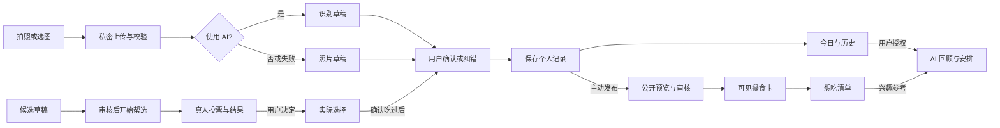

# 嘴巴等等我：产品方案 v0.4.0

日期：2026-10-28（Asia/Shanghai）。依据：最新草稿的一、二、三部分，以及此前拍照优先反馈。

状态：本轮优化补全的设计提案，未实现、未部署。作为最新方案供评审；具体实验参数不是用户已确认的上线承诺。应用仍为 v0.1.0。保留 [v0.3.0](v0.3.0.md) 与原始草稿，不把评估建议写成已验证事实。

## 本次评估：先把三个判断连起来

1. **核心问题成立为假设，但还缺用户证据。** 健康问题的社会规模，不能直接证明用户愿意持续拍照，更不能证明愿意付费。第一批要找的是“想改善日常饮食，但嫌记录麻烦、经常纠结下一餐”的人。
2. **定位已经从身体控制转向饮食决策。** 最新原稿明确社区只服务于决策，AI 用于快捷记录、分析和安排。建议以此为主线；陪伴来自及时、有上下文的回应，而不是增加群组和动态数量。
3. **场景需要分工。** 三餐记录提供事实；帮选处理当下纠结；收藏积累兴趣；AI 将历史和偏好转成下次可执行的选择。照片识别与营养估算分层，避免拍完又回到长表单。
4. **付费方向可以保留，付费时机需要实验。** 基础保存不收费，提供有限 AI 体验，高频识别、历史分析与安排作为付费候选。没有验证价格、成本和价值前，不开通真实收款。

本版建议将新社交流程从“批准我吃”改为“帮我选”。这是相对旧方案的重要提议，不追溯改变线上记录或投票含义。开发前仍须确认这一方向。

## 一、核心概念

### 1.1 为什么做

日常吃饭有三类负担：记不住吃过什么；知道应该调整，却不知道下一餐怎么选；已有记录工具要求持续填写，容易中断。

社会背景可以保留，但需准确标注：国家卫健委《体重管理指导原则（2024 年版）》引用的是 **2018 年**成人超重率 34.3%、肥胖率 16.4%，不是 2026 年最新调查。原稿“超过 67%”暂不纳入对外陈述，待确认原始出处、样本和年份。宏观数据只解释背景，不作为产品需求或疗效证据。[官方来源](https://www.nhc.gov.cn/wjw/c100378/202412/f3f58b54fbeb4c87b14164fac898bf08/files/1736390749000_59785.pdf)

### 1.2 一句话定位

**一个帮你轻松记下这餐、少纠结下一餐的饮食工具：拍照记录，需要时请人帮选，再用 AI 回顾和安排。**

健康是长期方向；首版交付的是记录省事、信息可回看、选择更具体。不承诺减重效果，不用“被批准”“低热量”替代是否适合用户的判断。

### 1.3 先服务谁

| 维度 | 第一批目标与边界 |
|---|---|
| 用户 | 愿意尝试记录、日常经常外食或点餐、希望少填信息的成年人 |
| 高频时刻 | 吃饭前后随手拍；下单前在几个候选中纠结；一周后想知道最近怎么吃 |
| 实际任务 | 记下、找回、比较、决定；体重不是注册必填 |
| 暂不承接 | 临床营养治疗、疾病饮食处方、儿童减重指导、竞技营养方案 |
| 不要求 | 加群、公开健康资料、每天完整打卡、等待别人同意才能吃 |

### 1.4 产品原则

- 单人使用就有价值，社区没有回应也不阻断记录。
- 默认私密；发布时选择公开内容，不顺带公开体重、历史或账号身份。
- 系统整理，用户确认；不确定可以留空，不逼用户编数字。
- 已吃、想吃、计划吃分别保存。收藏和投票不会自动增加摄入记录。
- 数据可找回、可更正、可删除；失败时明确告知，不能显示假的“保存成功”。
- 语气温和、简短，可在后续提供直接型／鼓励型选择，不支持羞辱或以体重判断诚实。

### 1.5 商业与产品关系

基础记录建立信任，帮选提供即时价值，AI 节省整理和安排时间。付费卖持续节省的时间，而不是解除人为制造的填写障碍。留存、有效回应、付费意愿分别验证，不能由其中一项推断其余成立。

## 二、竞品分析

### 2.1 证据口径

截至本次评估，钱包请等等的内容来自原稿体验观察；未重新取得其指定版本和五张嵌入截图，不将“没有某功能”写成客观结论。鸭觅、GoLite 下述信息来自开发者商店描述，不等于实机验收；平台版本之间也可能不同。

| 产品／替代方式 | 用户找它做什么 | 可核实信息或观察 | 对本产品的启发 |
|---|---|---|---|
| 钱包请等等 | 消费前求意见、形成行动前停顿 | 原稿认为发布手填多、群组入口不直观；收入输入与百分比算法尚未核实 | 具体选择比泛泛打卡更容易回应；发布成本必须小于用户获得的帮助 |
| 鸭觅 | 找餐厅、按口味发现与选择 | 官方描述包括口味匹配、推荐榜和组队找店 | 社区选餐不是空白；我们要验证的是自身饮食历史能否帮助下一餐选择，而非再做餐厅点评。[来源](https://apps.apple.com/cn/app/id6739762511) |
| GoLite | 日常体重、饮食与习惯管理 | Android 官方描述包含饮食记录、热量面板、趋势、状态记录和断食辅助 | “低负担、温和陪伴”已有竞争；原稿列出的 PK、Go 教练和手表体验仍需按平台实测。[来源](https://play.google.com/store/apps/details?hl=zh&id=emmo.golite.app) |
| 手机相册／聊天群 | 随手留照片、问朋友选哪个 | 作为待观察的现有替代路径，不假设用户一定使用 | 产品必须比“拍照留相册、群里发一句”多提供历史整理和可用结果 |

### 2.2 优化原来的判断

1. 群组不必然与微信重复：它可能承担权限、历史和固定参与者管理。但我们当前没有证据需要再造群组，先用可分享的帮选卡验证。
2. 随机小组、PK 不是群组问题的直接答案，它们还会增加匹配、反作弊和持续运营成本，先不做。
3. GoLite 是否“单人作战”，需要确认具体版本。即使属实，也不能据此推断用户需要陌生人社区。
4. 鸭觅已处理偏好与选择，差异化应落在“自己的日常记录 → 有依据的选择 → 实际结果回填”，不能只说“我们也有 AI”。

### 2.3 下一次竞品体验怎么做

每款使用同样三项任务：首次记录一餐；找到昨天的记录；在两个晚餐候选中做选择。记录必填项、主动操作时长、等待时长、纠错步骤、公开边界和付费触点。补充会员用户实际获得什么；没有测过的格子保留“待测”，不补造截图或结论。

## 三、核心场景

### 3.1 这餐记一下

**触发：** 已经吃了，或准备吃眼前这份餐食，想先留下记录。

**主流程：** 首页“记一餐” → 拍照／选图 → 识别确认卡 → 有错才改 → 保存 → 回到今日时间线。无照片时可写一句话或复用常吃内容。

- 先默认一张主图；多图作为后续扩展，上限九张暂不作为首发要求。同一餐的不同角度不重复累计食物。
- 自动带入当前时间、建议餐次、仅自己可见；可修改和补记。加餐、饮品同样能记，不能被“三餐”名称排除。
- 确认卡先展示食物标签。增加、删除、改名均可单项操作，不要求全文重写。
- 份量、备注、热量放在可展开详情。“多人共享”仅表示场景，不能简单用整桌热量除以人数。
- 未确定本人食用份量时只记食物，不生成确定的个人摄入。正在计划的餐食不能默认为已经吃过。
- 识别结果是建议；提交后保存用户确认版本。照片可以先单独保存，之后再识别或补充。
- 保存成功必须返回稳定记录标识并能在历史中重新读取；上传成功、识别成功均不能代替此状态。

**热量方案：** 保留估算作为扩展，不将它设为保存前提。照片分析、份量估计与营养推算是不同环节；区间中点只用于明确标注的粗估展示，不为了美观收窄范围。[研究依据](https://arxiv.org/abs/2108.02947)

对于糖、油、钠等无法从照片可靠确定的内容，标记未知，或使用用户提供的包装标签／明确配方来源；不能从看起来清淡直接推断低钠。估算不足时允许只提供食物组成，不输出伪精确克数。

**完成标志：** 用户不输入文字也能保存正确识别的一餐；隔天、重登后找得到原图和修正后的内容。

### 3.2 帮我选这餐

**触发：** 下单前已有几个候选，需要外部意见。

**主流程：** “帮我选” → 添加两个候选（照片、截图或文字） → 可选说明想解决什么 → 预览并发布 → 看票数和理由 → 自行决定 → 可选回填实际吃了什么。

- 首发建议单选、2–4 个候选；9 个选项、多选、人数上限延后。默认参数均是实验值。
- 默认投票窗口建议 30 分钟，发布时可改；以服务端截止时间为准，发布前审核耗时不计入投票窗口。
- 没人投时显示“还没有人给建议”，平票并列展示。票数只是人们的偏好，不自动判定哪份更健康。
- 用户随时可以先决定，关闭投票。回填实际选择不自动生成已吃记录，可一键带入新记录草稿再确认。
- 一个账号一票，截止前可改；本人不能投；有票后不直接替换候选，需结束后新建，避免原票意义被篡改。
- 首版他人只看到帖内化名；后台关联账号用于本人管理与限制重复投票。不能宣称平台也完全不知道是谁。
- “我的提交”可看状态、结果、关闭、撤回。公开链接只展示该卡片和用户主动选择的上下文，私密历史不随链接暴露。
- AI 候选解析为可选加速；无额度时文字／截图仍能发布。AI 不生成假票，也不伪装真人回答。

**冷启动：** 先用愿意互相帮选的小批试用者，在饭点验证回应。允许用户自行分享链接；不强制拉人，不自动向联系人发消息。若真实回应不足，就保留工具价值，暂缓扩张广场。

**完成标志：** 提问者能理解结果并自主决定；参与者几秒即可投票，不必阅读一份健康档案。

### 3.3 AI 饮食助手（原“AI 营养师”）

建议名称采用“AI 饮食助手”，避免让用户误认有真人营养专业服务。保留付费分析与安排方向，但先验证质量和效用。

**触发：** 想知道最近怎么吃，或不想再从零决定下一餐。

**输入：** 用户主动允许使用的已确认饮食记录、想吃清单、明确偏好与忌口；按需补充预算、可获得食物或准备时间，不一次性调查全部资料。

**输出：** 一段简短回顾 + 2–3 个能执行的下一餐选择 + 每项参考依据 + 可以替换的组成。需要菜名建议时不虚构附近餐厅营业、价格或库存。

- “三天”作为首次回顾的体验提示，不能当成了解用户的充分条件。明确展示参考日期、餐次和缺漏；数据少时给通用选择或提出一个必要问题。
- 收藏代表想尝试，不能推断已经吃过且喜欢；明确忌口优先于收藏。用户能查看和修改这些偏好。
- 用户可以换一个、不喜欢、收藏、加入计划；加入计划不计入摄入，吃过后再确认。
- 每次建议最多提出少量可执行变化；不因漏记指责用户，不把多数票作为营养证据。
- 普通工具不提供疾病处方或保证过敏原安全；相关限制明确时，不生成与之冲突的菜单。此处是产品能力边界，不要求注册时填写病史。
- 会员到期不删除历史、已保存的建议或计划；新分析受权益限制。

**完成标志：** 用户能选中、修改或拒绝一项建议；系统记录反馈供后续调整，不将“生成了长文本”作为成功。

### 3.4 想吃清单

**触发：** 看到一个候选或餐食，想以后试试。

点击“给我吃一口”，提示“已加入想吃”。清单支持回看、取消、标记吃过和喜欢／一般；可作为新帮选的候选或新记录的草稿。

点赞表示支持内容，收藏表示兴趣，吃过喜欢才是实际偏好。建议首版先做收藏，不同时扩展多套反应。原“别吃了”暂缓；如果为了过滤推荐，使用本人可见的“不感兴趣”。

来源内容撤回、转私密或被删除后，收藏不能继续暴露原作者图片和文字；显示“来源已不可用”，允许移除。用户自己另写的笔记可保留，但不能通过缓存绕过原内容权限。

**完成标志：** 收藏能帮助下一次选择，不只是多一个数字。

## 四、功能详述

### 4.1 信息架构

移动 Web 优先验证；后续原生 App／小程序复用同一账号与业务数据，不同时建立三套产品。

| 页面 | 主要内容 | 首版主操作 |
|---|---|---|
| 登录／注册 | 独立账号、服务与隐私说明、找回入口（上线前补齐真实找回能力） | 注册或登录，不要求 ChatGPT 账号 |
| 今天 | 今日餐食时间线、记录状态、日期入口；有可靠估算时附加摘要 | 记一餐 |
| 历史 | 按日期回看、补记、更正、删除；保留旧文字记录 | 找到昨天那餐 |
| 帮选 | 待投卡片／我的提交，截止与结果清楚 | 发起或投票 |
| 想吃 | 收藏列表、来源可用状态、个人反馈 | 选作候选或取消收藏 |
| 我的 | 偏好、隐私、提醒、账号、数据导出删除；后续会员 | 管理自己的数据和权益 |
| AI 助手（后续） | 回顾、选择建议、计划，展示依据与覆盖范围 | 选一个／换一个 |

首版导航不必把每个能力都做成底栏：建议“今天、帮选、我的”，想吃与历史可从相关页面进入。若只有记录阶段上线，隐藏尚不可用的入口，不摆假按钮。

### 4.2 首次使用与输入负担

注册后直接给“记第一餐”，不先索要身高、体重、每日热量目标。相机权限仅在拍照时请求，拒绝后仍可选图。AI 图片处理在第一次使用时说明处理目的、供应商与传输范围，必要时取得对应同意；拒绝 AI 不影响基础保存。

| 输入 | 默认／必要性 | 什么时候再问 |
|---|---|---|
| 餐食照片或一句话 | 至少一种内容 | 保存当前餐时 |
| 时间／餐次 | 自动建议，可修改 | 补记或跨时区时 |
| 可见范围 | 仅自己 | 主动发布时 |
| 食物名称 | AI 草稿或用户文字，允许待补充 | 有错时 |
| 份量、人数、热量、备注 | 选填 | 用户要完善估算时 |
| 体重、身高等 | 基础记录不收集 | 用户主动启用确有必要的个性化能力时另行说明 |
| 忌口、偏好、预算 | 不阻断记录 | 请求安排且对结果必要时 |

### 4.3 状态与失败处理

| 环节 | 用户看到的状态 | 失败后的行为 |
|---|---|---|
| 上传 | 上传中／待重试 | 保留本次编辑，明确尚未云端保存；关闭页面可能丢失未保存内容时给提示，不承诺未实现的离线同步 |
| 识别 | 识别中／待确认／未识别 | 可重试、手改或先存照片；迟到结果不得覆盖已确认内容 |
| 保存 | 保存中／已保存／未保存 | 重复点击和重试只生成一条记录；仅服务器确认后显示成功 |
| 发布 | 待审核／已公开／未通过／已撤回 | 正常餐照的个人保存不依赖公开审核；拒绝公开说明原因 |
| 投票 | 进行中／已结束／已撤回 | 超时不再收新票；零票和平票有明确结果，不补假票 |
| 页面读取 | 加载中／没有记录／读取失败 | 读取失败不能显示“0 餐、0 成就”冒充空数据；保留重试入口 |

公开餐食卡与帮选卡为两种内容。普通餐食发布后可收藏、支持；帮选卡才有候选与投票。历史旧审批明确标注旧规则，不用新的“帮选结果”重解释。

### 4.4 营养与首页展示

- 第一阶段显示吃过的内容；照片、用户文字和模型标签都有来源，用户修改优先。
- 后续估算同时标记来源、范围和覆盖情况；未知不记零。部分餐食的估算不能表示整日完整摄入。
- 不给所有人统一热量上限。个人目标应另行设计与验证，用户主动开启后才显示目标对比。
- 暂缓“今日健康评分”和食物好坏排名；保留可理解的事实回顾，例如已记录哪些餐次、哪些信息缺失。
- 成就若恢复，奖励记录、回看与帮助别人，不奖励少吃、拒绝次数或体重下降。

### 4.5 免费、试用与付费

以下是待测权益设计，不是现行套餐，也不承诺永久免费容量或无限模型调用。

| 能力 | 基础／试用 | 付费候选 |
|---|---|---|
| 照片／文字保存、纠错、历史、删除、导出 | 基础可用；合理文件与容量限制公开说明 | 不用会员锁住用户已有数据 |
| AI 识别 | 暂以每日 3 餐成功识别为试验值 | 更高明确额度；非无限承诺 |
| AI 候选解析 | 与识别共用额度，调用前提示 | 可纳入更高额度 |
| 帮选与收藏 | 基础可用，有反滥用限制 | 首版不付费买票／买优先通过 |
| AI 历史回顾与安排 | 可先做一次受限示例体验 | 会员核心候选，需先验证有用性 |

额度规则：按一次用户发起且成功返回可用结果的逻辑任务记账；同一任务网络重试不重复扣，失败或超时释放预留。一天按账号时区计算，首期默认上海时区，显示重置时间；禁止通过反复改时区刷新额度。新一轮主动刷新须先提示消耗，手动改错不扣；同一任务迟到成功但已被判失败的结果不得再次扣费。

支付前明确价格、周期、额度、续费与取消、退款规则。只以服务端确认的支付状态发放权益；重复回调幂等；会员到期保留数据。正式支付、供应商选择及任何付费资源均另需授权，本次不接支付。

### 4.6 社区、提醒与运营

公开发布前预览；公共内容提供举报、屏蔽与撤回。首轮投票可加少量结构化理由，开放评论后再增加文本审核与申诉能力，不默认开放私信、关注链或群聊。

反馈不羞辱身材、不鼓励挨饿。公开审核失败不等于本人没记录；对违法或有安全风险的上传依平台策略处理，不能承诺任何图片都可私密保存。

提醒自愿开启并可暂停。当前 Web 提醒不承诺关闭网页后可靠推送；不把后台通知当作已经实现的能力。社区需要真实运营与处置能力，不能只上线一个“举报”按钮却没有接收方。

## 五、系统和数据交互方式

### 5.1 数据怎么走

### 5.2 数据对象与隔离

| 对象 | 最少保存的内容 | 约束 |
|---|---|---|
| 账号与偏好 | 用户标识、时区、显式偏好、同意版本 | 身份验证在服务端，邮箱不公开 |
| 饮食记录 | 所属人、发生时间、餐次、照片关联、确认内容、来源与版本 | 日期来自发生时间，不是服务器创建日期；旧记录保留 |
| 图片资产 | 所属人、存储位置、处理状态、关联记录、清理状态 | 私密持久存储；移除不必要定位等元数据；不用 Render 临时磁盘充当永久相册 |
| 识别任务 | 请求标识、输入记录版本、状态、模型版本、返回草稿、额度流水 | 外部结果不直接覆盖记录；图片或用户文字不是系统指令 |
| 营养估算（后续） | 来源、份量假设、区间、未知项、用户修正 | 与原图、确认标签分开，可重算但不静默改变历史 |
| 发布内容 | 类型、允许公开字段快照、审核状态、撤回状态 | 不直接暴露个人记录全表；私密修改不会自动扩大公开内容 |
| 帮选与选票 | 候选版本、截止时间、作者、投票者、选择、结束原因 | 每人唯一有效票；截止和写入原子校验 |
| 收藏与反馈 | 用户、来源标识、兴趣类型、可用状态 | 访问时重新校验来源可见性，撤回后不泄露原图 |
| AI 建议与计划 | 参考记录标识／版本、生成时间、覆盖范围、反馈 | 建议与真实摄入分开；用户删除历史后按策略清理衍生上下文 |
| 权益与支付（后续） | 服务端确认的订单、有效期、额度流水 | 客户端不能自行提权；不保存银行卡数据 |

### 5.3 可靠性与权限

1. 所有私密记录与图片访问校验所属人，不能仅依赖隐藏按钮或难猜链接。模型凭证只保存在服务端。
2. 上传完成后在事务中关联记录，保存使用请求标识防重复；孤立图片设清理队列，失败后可以补偿。
3. 用户编辑后，旧识别任务只可显示为可选新草稿；记录版本冲突时提示合并，不静默覆盖。
4. 撤回公开内容后列表、详情和收藏都重新检查状态；缓存和临时图片链接撤销延迟须在设计中限定，不能只从首页移除。
5. 导出只包含本人可访问数据；删除流程覆盖原图、衍生图、记录及关联 AI 上下文。备份保留周期与第三方删除能力上线前确定并告知，不虚构“即刻彻底清除”。
6. 业务日志只记必要标识、状态、耗时与错误码；不打印连接串、照片、完整饮食内容或用户身份资料。
7. 数据库与图片要分别备份，并演练恢复；从应用重启、重新部署到跨天回看都要验证。生产数据不进入 GitHub。

### 5.4 与当前应用兼容

当前 v0.1.0 的独立账号、文字记录、私密规则和旧审批保留。本方案落地采用新增图片、识别任务和独立帮选对象的增量迁移。旧投票不转成新候选票，旧通过率不混入新帮选指标。已有提醒与成就保留数据，但新首屏不强制突出。

功能可分阶段开关；关闭识别不影响历史访问。部署前备份和演练，回退应用时保留新增数据，不执行破坏性回滚。原 Sites 与 Render 数据若需合并，另做有授权、有备份的迁移，本方案不假定已互通。

### 5.5 成本与供应商

暂不选定供应商、不承诺免费额度足够。预算应包括成功识别、重试、图片存储与传输、公开审核、数据库、监控及支付渠道成本。按“每个成功保存且用户可接受的记录”核算，不只看模型单次调用价格。

上线前设置单账号额度、全局预算上限和熔断；超限降级到照片／文字记录。选型核查处理地区、训练用途、保留删除、访问控制和数据条款。Render／Neon 现有免费试用条件与未来模型、图片服务分开评估。

## 六、上线和登记准备

### 6.1 先确定发布顺序

先完成移动 Web 小规模验证，再决定小程序或原生 App 是否值得投入。App 是可能的最终载体，不是验证拍照价值的先决条件。下表是准备清单，不代表已完成备案、审核或取得经营资格。

| 阶段 | 必须准备 | 通过条件 |
|---|---|---|
| Web 试用 | 拍照与存储条件、账号恢复、隐私说明、基础删除与故障反馈、手机网络测试 | 真实记录可保存找回；识别出错有退路；关键权限测试通过 |
| 公开帮选 | 主体与服务范围核查、内容审核、举报处置与响应安排、反滥用、分享权限 | 能撤回和处置公开内容；无私密数据随卡片泄露 |
| AI 商业试用 | 供应商数据与成本条件、输出验证、权益定义、明确价格和取消退款路径 | 用户看得懂权益；预算可控；正式收费前另获授权 |
| 小程序／原生 App | 主体、平台类目资格、备案、隐私权限声明、账号注销、审核账号与测试材料 | 按所选平台及业务逐项核验后提交；不提前承诺审核通过 |

### 6.2 个人主体与备案

个人主体不等于没有备案路径，也不等于所有社区、健康和付费类目都可经营。要结合实际服务内容、主体所在地和分发平台核验，不以“海外服务器”作为所有手续豁免的结论。

面向中国境内提供服务的 App 需按工信部要求核查备案；官方解读说明通过网络接入服务提供者或分发平台在线提交，拟开展业务的 App 应先完成手续。网站、App、小程序不是获得一个号码即可互相替代的交付项；具体材料与类目在选定平台后确认。[工信部说明](https://www.miit.gov.cn/jgsj/xgj/hlwgl/art/2023/art_564bf0759d7e41d5b4aa8ce4996b9e84.html)

建议先整理：产品名称与简介、主体及联系人、域名／网络资源信息、功能范围、内容审核机制、隐私政策、第三方清单、删除注销路径。身份材料只提交给官方受理方，不放进公共产品仓库。商标、软件著作权与备案用途不同，是否需要由具体平台或业务要求核实，不当作普遍统一前置条件。

### 6.3 健康与跨境数据

涉及医疗健康信息时，应按敏感个人信息规则核查必要性、保护措施和单独同意；跨境提供个人信息还需核查接收方告知、单独同意及适用出境条件。当前 Render／Neon 和未来模型的处理地区都应纳入检查，不能认为一个隐私勾选框解决所有问题。[个人信息保护法第 28、29、38、39 条](https://www.miit.gov.cn/jgsj/zfs/fl/art/2022/art_515a4b20c12f430eab54bb4f56d89f56.html)

上述为基于官方材料的产品准备事项，实际经营、数据路径和平台选定后仍需有针对性的核验。首版减少非必要健康采集，也能减少填写负担与数据责任。

## 七、MVP 范围、验证与推进

### 7.1 分阶段交付

| 阶段 | 本阶段交付 | 暂不纳入 |
|---|---|---|
| A：可靠拍照记录 | 拍照／选图、真实识别试用、单项纠错、照片兜底、私密保存、历史、删除 | 精确营养、热量目标、付费收款、复杂成就、社区扩张 |
| B：具体决策 | 简单帮选、本人提交、结果回填、想吃清单、必要审核与举报 | 群组、PK、私信、社交关系、复杂多选规则 |
| C：付费价值实验 | 有来源的回顾与安排、有限权益试验、成本评估 | 未核验的疾病建议、保证减重、无限调用承诺 |

“A 完成”不代表整体产品假设成立；B 检验是否有人及时回应，C 检验是否愿意为持续省事付费。

### 7.2 第一轮试用与指标

建议招募 5–10 位愿意尝试的成年人，连续试用 7 天；这些是实验规模建议，不是统计充分性结论。先观察各人一次首次记录与一次纠错，再观察自然使用。不给用户“必须完整三餐”的任务来制造虚假留存。

| 要验证的假设 | 指标定义与证据 | 观察后的动作 |
|---|---|---|
| 记录足够省事 | 从拍照入口至服务端保存的时长，主动操作与等待分开；中位数与慢样本；无键盘保存数／成功拍照记录数 | 必填或纠错耗时高先减步骤；模型慢先优化等待和兜底 |
| 不会再找不到记录 | 对已显示保存成功的测试记录，跨天／重登／重启后逐条核对；区分读取失败与无数据 | 任一丢失、误报成功或越权均阻断扩大试用 |
| 用户愿意继续 | 第 2 天、第 7 天有主动记录的人数／已到相应观察日的首次记录用户数；展示人数与分母 | 回访问中断原因，不把小样本当成市场留存预测 |
| 帮选及时有用 | 公开且满观察窗口的卡片中，截止前获至少一名其他真人投票的占比；首票时长；提问者自报是否帮助决定 | 无回应多则先收缩社区；采纳率不等于健康效果 |
| AI 值得付费 | 已体验完整建议者的有用反馈、愿意继续的理由；获得收费授权后再看真实付费与退款 | 先改输出，不以“点击会员按钮”冒充购买 |
| 成本可持续 | 每次可用识别与每位活跃用户的模型、存储、审核成本；失败重试单列 | 调额度、压图与缓存，必要时暂停 AI 而保留基础记录 |

试用招募与反馈留在私有渠道；公共仓库仅记录汇总方法和不含个人数据的结论。性能数值目标在第一次基线测试后设定；不能将暂定 3 次、30 分钟、7 天写成已验证最优值。

### 7.3 必须通过的验收场景

1. 不输文字完成正确识别的一餐；一个标签错误只改该项；无照片也能记录。
2. 无额度、模型超时、无网络、重复点击时有明确状态，不扣重、不存重、不假报成功。
3. 隔天重登、服务重启后原图和修正值仍在；跨用户不能读私密图片和记录。
4. 共享餐份量未知时不编个人摄入；缺少记录时不显示全天完整热量。
5. 发布审核失败仍能找回个人正常餐照；撤回后详情、收藏和分享入口不再泄露内容。
6. 截止并发投票、自投、重复投票被正确处理；零票和平票可理解；选择回填不自动算作吃过。
7. 用户已改内容时迟到识别不覆盖；删除记录后旧任务不能复活记录或重新写入衍生内容。
8. 支付阶段另验重复回调、到期、退款和取消；未实现支付时不展示可购买承诺。

## 八、版本变更与待决策项

相对 v0.3.0：保留拍照优先；新增“社区只做具体决策”的产品提议、帮选与收藏规则、付费 AI 分层、完整页面与异常状态、数据关系、上线准备及分阶段验证。热量从默认首页核心改为可选且有覆盖说明的实验。复杂审批不是本次首发依赖。

下一步开发前需要明确的产品选择仅三项：

1. 是否采纳“帮选”替代新流程的“允许／不允许”，并保留旧审批为历史规则？本版建议采纳。
2. 是否按 A → B → C 顺序交付，营养估算与收费后置？本版建议如此。
3. 真实识别供应商、图片存储、预算与数据条件是否可接受？尚未选定；付费必须另行授权。

其余如 3 次额度、30 分钟、2–4 个候选，先作为可调试验值，不要求用户逐项拍板。方案评审通过后再形成开发任务；本次不修改应用、数据库、生产配置，也不迁移真实用户数据。

归档按 [版本规则](../../VERSIONING.md) 创建 `plan/v0.4.0` 固定标签；所有旧方案和标签保留。后续修订新增版本，不覆写本快照。
